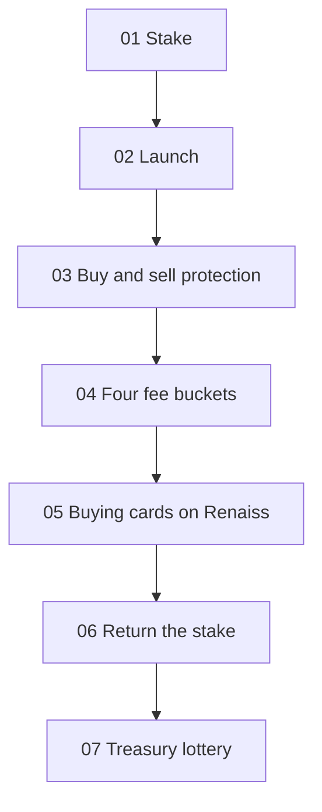

# 02 · Mechanism (seven steps)

One theme goes through the seven steps below. Where the draft does not give a threshold or a time, no number is filled in.

## 01 Stake

One or more people stake graded cards of that theme. The pool has a hard cap of about **$1,000**, first come, first served. Anything above the cap is returned (for example, $1,400 put in counts only as the first $1,000). The platform may take about **10–30%** of a new pool, and it does not fill a pool by itself.

Participants whose stake counts toward the cap share about **5%** of that theme token’s supply. Each person’s share then unlocks **daily over 30 days** to that person’s address. A staker is not necessarily the controller of the theme token. Grading and custody connect to Renaiss on-chain custody. When the pool is full, a receive-and-pay address is created.

## 02 Launch

One theme corresponds to one theme token. The launchpad itself remains the platform.

## 03 Buy and sell protection

The soft cap on the raise is about **$100,000**. The share that can be sold immediately depends on how fast the pool fills. A fast fill uses the progress track (about ≤35% / 35–70% / >70% → 10% / 20% / 30%). A slow fill uses the time track (about 1 hour / 2 hours / 3 hours or later → 10% / 20% / 30%). The rest unlocks over about **10 days**. Bands are in [04-buy-protection.md](./04-buy-protection.md).

## 04 Four fee buckets

The fee on each trade is split 40% Treasury, 20% Platform, 20% Staker share, and 20% Buyback & burn. A theme token’s total fee is a fixed **2.5%**. TCA is **10%**, then **5%** after about **$1M** cumulative volume, then **2.5%** after about **$10M**. After a step-down, the buckets still split 40/20/20/20. See [03-fees-treasury.md](./03-fees-treasury.md).

## 05 Buying cards on Renaiss

The platform carries out the 40% treasury under the rules: it buys graded cards of that theme on Renaiss, and it buys back the platform token, TCA.

## 06 Return the stake when the threshold is met

The threshold and the timing are not set. The lean is to wait until the buy unlock of about 10 days has finished, then return the stake. Under the official rules, the stake is returned to the participants whose stake counted toward the cap.

## 07 Treasury lottery

Each theme treasury can open its own draw. Eligibility is in [05-lottery.md](./05-lottery.md). The intention is to reveal a result about every 24 hours.
