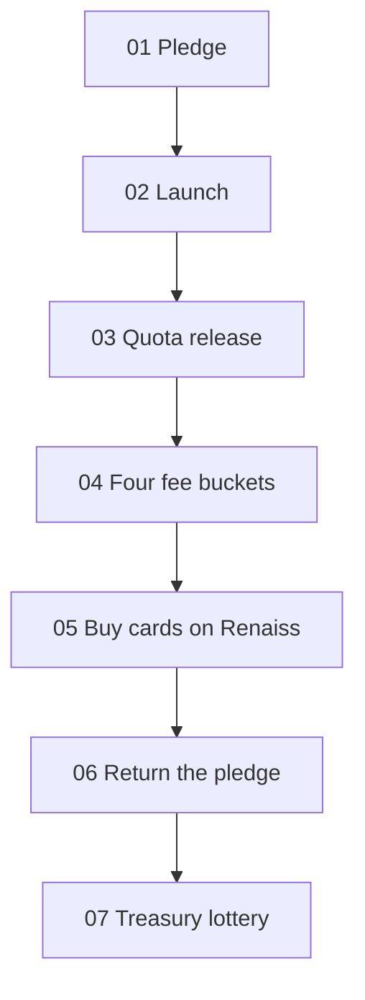

# 02 · Mechanism (seven steps)

A theme runs through the seven steps below. Where this draft does not give a threshold or a time, the number stays blank.

## 01 Pledge

Every theme starts with people, not a contract. To open a theme's pool, supporters pledge graded cards of that theme. The pool is capped at about **$1,000** and capped **per person at $200**, so a theme needs **at least 5 counted pledgers** before it opens. A card worth more than $200 still only counts as $200. Pledging is whitelisted: submit an X account, and only reviewed addresses may enter the pool. Counted pledgers split about **5%** of the theme token supply equally, unlocked daily over **30 days**.

Pledgers are not depositors. They are the founding community. They stake their cards behind a theme from day zero, claim its first allocation, and build the community the token deserves. If community pledging falls short, the treasury may step in for **up to 20% of a pool, at the Council's discretion**. When pledging is strong, the platform stands aside. The treasury exists so no theme dies for lack of a few believers. It does not replace them.

Theme pools are card-first: **at least half of the counted value must be pledged cards**. The remainder may be pledged in **TCA**, the one point where the platform token enters a theme's mechanics. Grade and custody connect to Renaiss on-chain custody.

The 5% supply reward is not the 20% fee bucket. See [03-fees-treasury.md](./03-fees-treasury.md) and [08-supply-backing-liquidity.md](./08-supply-backing-liquidity.md).

## 02 Launch

One theme, one token. The sale fills toward the soft cap of about **$100,000**. Once the soft cap is reached, the token launches and trades freely from that moment on. The launchpad itself stays the platform.

## 03 Quota release

During filling, a buyer receives only part of the purchase immediately. The instantly released share is **10% / 20% / 30%**, set by the first track to trigger. The rest stays locked and releases daily over **21 days**. Once the soft cap launches, this rule lapses. Bands are in [04-buy-protection.md](./04-buy-protection.md).

## 04 Four fee buckets

Fees on each trade split **40% treasury · 20% platform · 20% pledgers · 20% buyback-burn**. Theme tokens charge a flat **2.5%**. The fees section names the third bucket **Staker share**: it goes to pledgers whose pledges counted toward the cap. See [03-fees-treasury.md](./03-fees-treasury.md).

## 05 Buy cards on Renaiss

The platform executes the 40% treasury by the rules: buy graded cards of that theme on Renaiss, and buy back the platform token TCA. Purchases and offers are disclosed on a regular basis.

## 06 Return the pledge

Before launch, a pledge can be withdrawn and the card returned. After a successful launch the pledge locks for **30 days**, then unlocks automatically. Threshold and timing follow the formal release.

## 07 Treasury lottery

Opened per theme treasury. A perk, not a paid raffle. Eligibility is holding, not spending. See [05-lottery.md](./05-lottery.md). This page does not sell tickets or draw winners.
