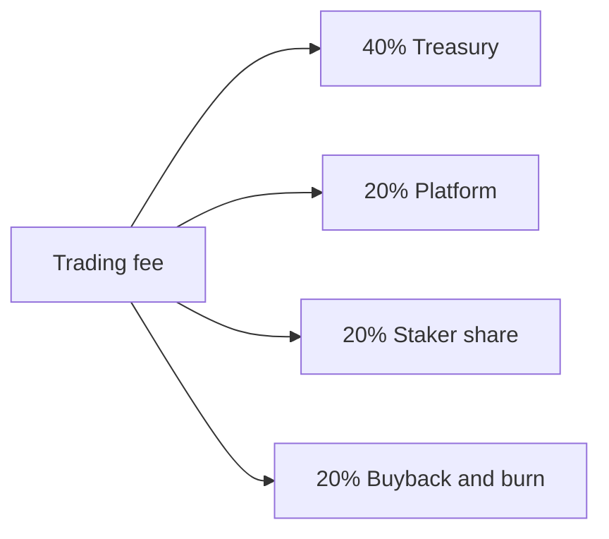

# 03 · Fees and the treasury

Trade fees split **40 / 20 / 20 / 20**. The four shares add up to 100%.

| Share | Use |
|------|------|
| 40% | **Treasury.** Buy graded cards of that theme on Renaiss, and buy back the platform token TCA. Purchases and offers are disclosed on a regular basis. |
| 20% | **Platform.** Runs the launchpad. It stays with the platform. |
| 20% | **Staker share.** Goes to pledgers whose pledges counted toward the cap. For theme tokens this share belongs to that theme's pledgers. The seven-step shorthand calls this bucket **20% pledgers**. |
| 20% | **Buyback & burn.** Buys back and burns the token that this trade is for. Supply only shrinks. |

**Theme tokens: a flat 2.5%.** Every fee still splits 40 / 20 / 20 / 20.

TCA is both the name of the launchpad and, in this draft, the platform token the treasury can buy back.

Counted separately: about **5%** of the theme-token supply is split equally by counted pledgers and unlocked daily over 30 days. That supply reward does not draw on the four buckets. The card itself is a refundable pledge. The 5% is the reward, not the compensation.
