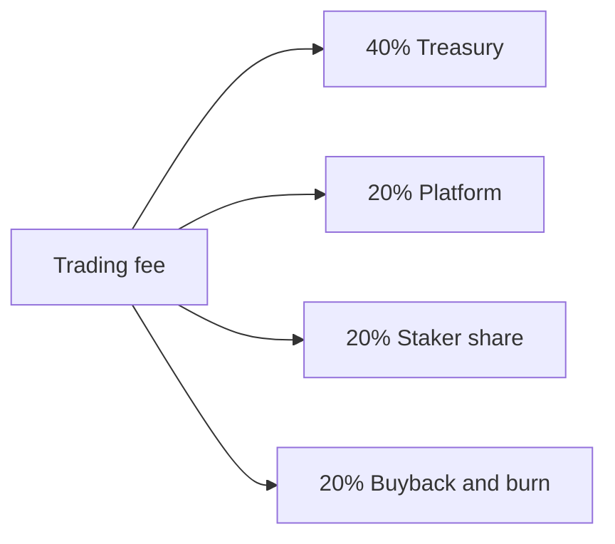

# 03 · Fees and the treasury

Trading fees split **40 / 20 / 20 / 20** (Treasury / Platform / Staker share / Buyback & burn). The four shares add up to 100%.

| Share | Use |
|------|------|
| 40% | **Treasury.** The platform carries this out under the rules: buy graded cards of that theme, and buy back the platform token, TCA. The split between those two uses is not set. |
| 20% | **Platform.** Running the launchpad. This share stays with the platform. |
| 20% | **Staker share.** Paid to staking participants whose stake counted toward the cap. |
| 20% | **Buyback & burn.** Buy back and burn **the token of that trade** (TCA trades burn TCA; theme-token trades burn that theme token). |

Counted separately: the staking token reward (about 5% of the theme-token supply, unlocked daily over 30 days) does not draw on the four buckets.

## Dynamic total fee (draft · not set)

At or under about $300K of cumulative volume, the total fee is about **10%**. Higher bands step down, and the top band points toward about **6%**. The middle bands, the exact triggers, and how volume is measured are not set. After a reduction, the four buckets still split 40/20/20/20.
